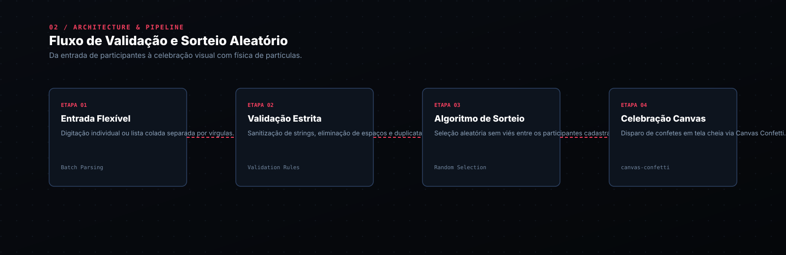

[Português (Brasil)](README.md) · **English** · [Español](README.es.md)

<picture>
  <source media="(prefers-reduced-motion: reduce)" srcset="docs/assets/readme/hero-still.svg">
  
</picture>

# Amigo Secreto Web App

**Aplicação web interativa, leve e moderna para sorteio rápido de amigos com inserção em lote e celebração animada com confetes!**

Ideal para confraternizações, dinâmicas de equipe, festas de fim de ano e salas de aula, com validação inteligente contra duplicatas e execução instantânea no navegador sem dependências de servidor.

<p align="center"><a href="#demo"><strong>VER DEMONSTRAÇÃO →</strong></a> &nbsp; · &nbsp; <a href="#start"><strong>COMO USAR</strong></a> &nbsp; · &nbsp; <a href="#architecture"><strong>ARQUITETURA</strong></a> &nbsp; · &nbsp; <a href="#features"><strong>RECURSOS</strong></a> &nbsp; · &nbsp; <a href="#credits"><strong>CRÉDITOS</strong></a></p>

---

<a id="demo"></a>
## 00 / Demonstração em vídeo

<p align="center">
  
</p>

---

<a id="start"></a>
## 01 / Prepare e execute a base

Não requer instalação de Node.js nem servidores externos:

```bash
# 1. Clone o repositório
git clone https://github.com/EmmanuelNunes/amigosecreto.git
cd amigosecreto

# 2. Abra no navegador
# No Windows:
start index.html
# No Linux:
xdg-open index.html
# No macOS:
open index.html
```

---

<a id="architecture"></a>
## 02 / Arquitetura e fluxo de processamento

<picture>
  <source media="(prefers-reduced-motion: reduce)" srcset="docs/assets/readme/architecture-still.svg">
  
</picture>

---

<a id="features"></a>
## 03 / Recursos, capacidades e uso prático

1. **Adição Inteligente em Lote:** Cole uma lista completa de nomes separados por vírgula (ex: `Lucas, Maria, Carlos, Fernanda`) e todos são adicionados instantaneamente.
2. **Prevenção de Duplicatas e Sanitização:** Impede nomes repetidos, entradas em branco e remove espaços desnecessários.
3. **Tags Visuais Interativas:** Cada amigo adicionado aparece como um chip com botão de exclusão rápida.
4. **Celebração com Confetes:** Ao clicar em Sortear, o nome é exibido em destaque com uma chuva de confetes animada pelo `canvas-confetti`.

---

<a id="structure"></a>
## 04 / Estrutura do repositório

```text
amigosecreto/
├── index.html          # Estrutura HTML5 da aplicação
├── app.js              # Regras de negócio, inserção em lote e sorteio
├── style.css           # Estilos visuais e temas responsivos
├── assets/
│   └── banner_amigo.svg
├── docs/assets/readme/
│   ├── hero.svg + hero-still.svg
│   └── architecture.svg + architecture-still.svg
├── AGENTS.md           # Instruções e contratos para agentes de IA
├── CLAUDE.md           # Ponte para Claude Code (@AGENTS.md)
├── README.md           # Documentação em Português (Brasil)
├── README.en.md        # Documentação em Inglês
└── README.es.md        # Documentação em Espanhol
```

---

<a id="credits"></a>
## 05 / Créditos e licença

Desenvolvido por **Emmanuel Nunes** como parte do ecossistema de ferramentas web leves.
Conectado ao [EmmanuelNunes/vibe-coding-toolkit](https://github.com/EmmanuelNunes/vibe-coding-toolkit).

Licenciado sob a Licença MIT. Consulte [LICENSE](LICENSE) para detalhes.

<p align="center">
  <br>
  <strong>BUILD WITH INTENT. SHIP WITH FLOW.</strong>
  <br><br>
  <a href="#amigo-secreto-web-app">Voltar ao topo ↑</a>
</p>
